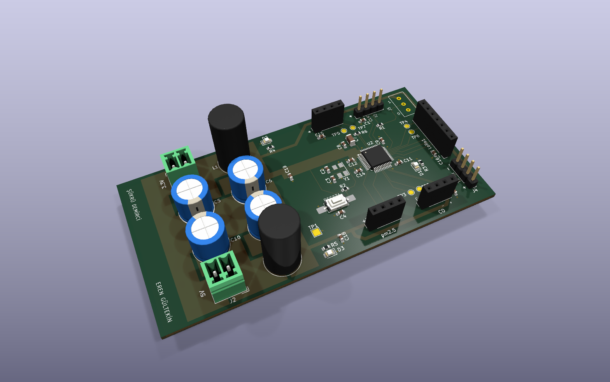
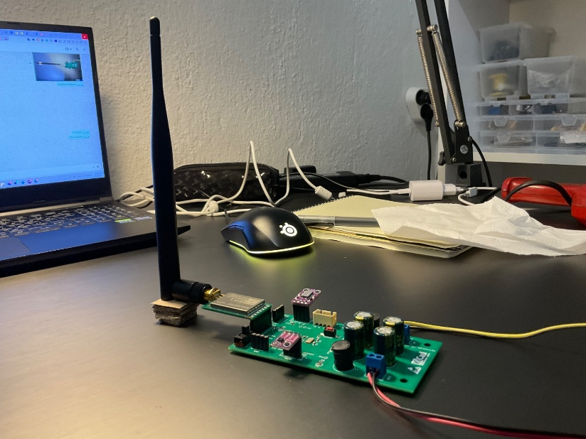
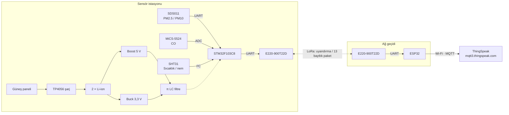
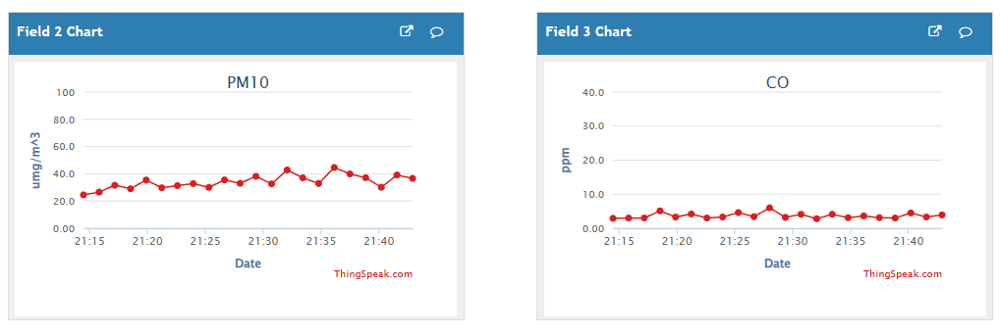
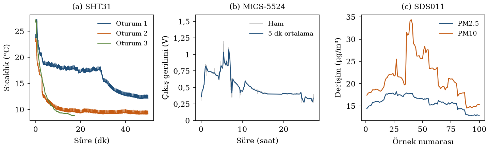

# LoRa Tabanlı Hava Kalitesi İzleme İstasyonu

Bu proje, düşük maliyetli, güneş enerjisiyle çalışan ve tamamen açık kaynak bir hava kalitesi izleme istasyonudur. İstasyon PM2.5, PM10, CO, sıcaklık ve bağıl nem ölçer. Ölçümler LoRa ile bir ağ geçidine, oradan da herkese açık bir ThingSpeak kanalına iletilir.

[](LICENSES/CERN-OHL-P-2.0.txt)
[](LICENSES/MIT.txt)
[](LICENSES/CC-BY-4.0.txt)


<p align="center">
  
  
</p>

> Bu depo, *"Düşük Maliyetli, Güneş Enerjili ve Açık Kaynaklı LoRa Tabanlı Hava Kalitesi İzleme İstasyonu"* başlıklı makalenin tamamlayıcı deposudur (Ş. Demirci, İ. Baştürk; Manisa Celal Bayar Üniversitesi). Makale yayımlandığında künyesi [Atıf](#atıf) bölümüne eklenecektir.

## İçindekiler

- [Öne çıkanlar](#öne-çıkanlar)
- [Sistem mimarisi](#sistem-mimarisi)
- [Donanım](#donanım)
- [Depo yapısı](#depo-yapısı)
- [Hızlı başlangıç](#hızlı-başlangıç)
- [LoRa veri paketi](#lora-veri-paketi)
- [Canlı veri](#canlı-veri)
- [Test verileri](#test-verileri)
- [Bilinen sınırlılıklar](#bilinen-sınırlılıklar)
- [Gelecek çalışmalar](#gelecek-çalışmalar)
- [Atıf](#atıf)
- [Lisans](#lisans)
- [Proje ekibi](#proje-ekibi)

## Öne çıkanlar

- **Şebekeden bağımsız:** Güneş paneli, TP4056 şarj devresi ve iki Li-ion hücreyle çalışır.
- **Altyapı gerektirmeyen haberleşme:** E220-900T22D modülleri noktadan noktaya LoRa bağlantısı kurar; LoRaWAN ağ sunucusuna ihtiyaç yoktur.
- **Özgün devre kartı:** STM32F103C8 tabanlı 2 katmanlı kart, KiCad ile tasarlanmıştır (100 × 50 mm).
- **Düşük gürültülü besleme:** Anahtarlamalı dönüştürücülerin gürültüsü π tipi LC filtreyle bastırılır, böylece analog CO ölçümü korunur.
- **Herkese açık veri:** Ölçümler ESP32 ağ geçidi üzerinden MQTT ile ThingSpeak'e gönderilir.
- **Yeniden üretilebilir:** Kart, yazılım, malzeme listesi, test verileri ve şekil betiği bu depodadır.

## Sistem mimarisi



Ağ geçidi 60 saniyede bir istasyona bir uyandırma baytı gönderir. İstasyon bu baytı UART kesmesiyle alır ve şu adımları sırayla yürütür:

1. Her sensörden 10 örnek alır (SHT31 → MiCS-5524 → SDS011).
2. Örneklerin ortalamasını hesaplar.
3. Sonucu 13 baytlık bir paket olarak geri gönderir.

Ağ geçidi paketi doğrular ve ThingSpeak'e yayımlar.

## Donanım

| Bileşen | Ölçülen | Arayüz | STM32 pinleri |
|---|---|---|---|
| [SDS011](https://www.nova-fitness.com/) | PM2.5, PM10 (0–999,9 µg/m³) | UART, 9600 bit/s | USART2 (PA2/PA3) |
| [SHT31](https://sensirion.com/products/catalog/SHT31-DIS-B) | Sıcaklık, bağıl nem | I²C | I2C1 (PB6/PB7) |
| [MiCS-5524](https://www.sgxsensortech.com/) | CO / indirgeyici gazlar (eğilim göstergesi) | ADC, 12 bit | ADC1_IN8 (PB0) |
| [E220-900T22D](https://www.cdebyte.com/products/E220-900T22D) | LoRa haberleşme (LLCC68) | UART, 9600 bit/s | USART1 (PA9/PA10) |

- Şema (PDF): [`donanim/sema.pdf`](donanim/sema.pdf)
- KiCad projesi: [`donanim/kicad/`](donanim/kicad/)
- Üretim dosyaları (Gerber ve delik dosyaları): [`donanim/gerber/`](donanim/gerber/)
- Malzeme listesi: [`belgeler/malzeme-listesi.md`](belgeler/malzeme-listesi.md)

Ayrıntılar için bkz. [`donanim/README.md`](donanim/README.md).

## Depo yapısı

```
├── donanim/
│   ├── kicad/                  KiCad 9 projesi (şematik, kart, özel kütüphaneler)
│   ├── gerber/                 Üretici için Gerber ve delik dosyaları
│   ├── sema.pdf                Devre şeması
│   └── malzeme-listesi-kart.csv
├── yazilim/
│   ├── istasyon-stm32/         STM32CubeIDE projesi (sensör istasyonu)
│   └── ag-gecidi-esp32/        Arduino taslağı (LoRa → Wi-Fi/MQTT ağ geçidi)
├── veri/                       Sensör birim testlerinin ham kayıtları (CSV)
├── betikler/                   Şekil üretme ve seri port kayıt betikleri (Python)
├── belgeler/                   Malzeme listesi ve görseller
├── LICENSES/                   Lisans metinleri
├── CITATION.cff
└── LICENSE
```

## Hızlı başlangıç

### 1. Kartı ürettirmek

[`donanim/gerber/`](donanim/gerber/) klasöründeki dosyaları sıkıştırıp bir PCB üreticisine yükleyin. Kart özellikleri: 2 katman, FR-4, 1,6 mm, 100 × 50 mm. Bileşenler elle lehimlenebilecek boyuttadır (0603 / 0805 / LQFP-48).

### 2. İstasyon yazılımı (STM32)

1. [STM32CubeIDE](https://www.st.com/en/development-tools/stm32cubeide.html) ile `yazilim/istasyon-stm32` klasörünü içe aktarın: *File → Import → Existing Projects into Workspace*.
2. `AllSesnsorRead.ioc` dosyasını açıp **Generate Code** komutunu çalıştırın. Bu adım HAL sürücülerini (`Drivers/`, STM32Cube FW_F1 V1.8.6) indirir; sürücüler depoya konmamıştır.
3. Projeyi derleyin ve kartın SWD bağlantısı üzerinden ST-LINK/V2 ile yükleyin.

### 3. Ağ geçidi yazılımı (ESP32)

1. Arduino IDE'ye ESP32 çekirdeğini ve **PubSubClient** kütüphanesini kurun.
2. `yazilim/ag-gecidi-esp32/ag_gecidi_esp32/secrets.example.h` dosyasını aynı klasöre `secrets.h` adıyla kopyalayın. İçine Wi-Fi bilgilerinizi ve ThingSpeak MQTT cihaz bilgilerinizi yazın.
3. `ag_gecidi_esp32.ino` dosyasını ESP32'ye yükleyin. E220 modülü UART2'ye bağlanır: ESP32 RX = GPIO16, TX = GPIO17. M0 ve M1 LOW olmalıdır; ayrıntı için bkz. [`yazilim/README.md`](yazilim/README.md).

### 4. LoRa modüllerinin yapılandırılması

İki E220 modülü, üreticinin yapılandırma yazılımıyla aşağıdaki gibi ayarlanır:

| Parametre | Değer |
|---|---|
| UART | 9600 bit/s, 8N1 |
| İletim kipi | Sabit adresli (fixed transmission) |
| Hava veri hızı | 62,5 kbit/s |
| Adres | 0x0001 (istasyon), 0x0002 (ağ geçidi) |
| Kanal | Bkz. [Bilinen sınırlılıklar](#bilinen-sınırlılıklar) |

## LoRa veri paketi

| Bayt | İçerik | Kodlama |
|---|---|---|
| 0 | Başlangıç baytı | `0xAA` |
| 1–2 | PM2.5 (µg/m³) | 16 bit, düşük bayt önce, ×10 |
| 3–4 | PM10 (µg/m³) | 16 bit, düşük bayt önce, ×10 |
| 5–6 | CO kanalı | 16 bit, düşük bayt önce, ×10 |
| 7–8 | Sıcaklık (°C) | 16 bit, düşük bayt önce, ×10 |
| 9–10 | Bağıl nem (%) | 16 bit, düşük bayt önce, ×10 |
| 11 | Sağlama baytı | (b₁ + … + b₁₀) mod 256 |
| 12 | Bitiş baytı | `0xAB` |

Ağ geçidi değerleri ThingSpeak alanlarına şöyle yazar: `field1` PM2.5, `field2` PM10, `field3` CO, `field4` sıcaklık, `field5` bağıl nem.

## Canlı veri

İstasyonun verileri herkese açık ThingSpeak kanalında yayımlanır: **[thingspeak.mathworks.com/channels/2948169](https://thingspeak.mathworks.com/channels/2948169)**

<p align="center">
  
</p>

## Test verileri

Makaledeki sensör birim testlerinin ham kayıtları [`veri/`](veri/) klasöründedir. Makaledeki şekil şu komutlarla yeniden üretilebilir:

```bash
pip install matplotlib
python betikler/sekil_uret.py
```

<p align="center">
  
</p>

Dosyaların içeriği ve ölçüm koşulları için bkz. [`veri/README.md`](veri/README.md).

## Bilinen sınırlılıklar

Bu sürüm bir prototiptir. Aşağıdaki konular açıkça belirtilmektedir:

- **Ölçek uyuşmazlığı:** Ağ geçidi her değeri 10'a bölüyor (×10 kodlama). Ancak istasyon yazılımı PM değerlerini zaten 10'a bölünmüş tamsayı (µg/m³) olarak, SHT31 değerlerini ham sensör sayımı olarak, CO değerini ise ham ADC sayımı olarak gönderiyor. Paket biçimi makalede tanımlandığı gibidir; istasyon yazılımının bu biçime uydurulması gerekiyor.
- **Uyku kipi:** Ölçüm döngüleri arasında SLEEP kipine geçiş ayrı bir test yazılımında doğrulandı, ancak bütünleşik yazılımda henüz etkin değil.
- **Kalibrasyon yok:** Sensörler bir referans cihazla karşılaştırılmadı. MiCS-5524 kanalı nicel bir CO derişimi olarak değil, eğilim göstergesi olarak yorumlanmalıdır.
- **LoRa kanalı:** Yazılımlarda kanal `0x02` tanımlı. E220-900 modülünde bu, 852,125 MHz'e karşılık gelir. Türkiye'de lisanssız kısa menzilli cihazlar için 863–870 MHz bandı kullanılmalıdır (ör. kanal 18 = 868,125 MHz). Sahada kullanmadan önce kanal ayarını yerel düzenlemelere göre değiştirin.
- **Menzil:** LoRa bağlantısı yalnızca yaklaşık 227 m görüş hattında sınandı. RSSI/SNR ve paket teslim oranı kaydedilmedi.

## Gelecek çalışmalar

- İstasyon yazılımında ölçek uyuşmazlığının giderilmesi ve uyku kipinin etkinleştirilmesi
- Referans istasyonla yan yana kalibrasyon
- Uzun süreli saha testi, enerji bütçesi ve paket teslim oranı ölçümleri
- ThingSpeak bağımlılığını kaldırmak için açık kaynak bir sunucu yığını (MQTT aracısı, zaman serisi veritabanı, Grafana)

## Atıf

Bu çalışmayı kullanırsanız lütfen makaleye atıf yapın. GitHub'daki **"Cite this repository"** düğmesi [`CITATION.cff`](CITATION.cff) dosyasındaki bilgileri kullanır.

```bibtex
@misc{demirci_lora_hava_kalitesi,
  author       = {Demirci, Şükrü and Baştürk, İlhan},
  title        = {Düşük Maliyetli, Güneş Enerjili ve Açık Kaynaklı LoRa Tabanlı
                  Hava Kalitesi İzleme İstasyonu},
  howpublished = {\url{https://github.com/sukrudmrc/lora-hava-kalitesi-istasyonu}},
  note         = {Makale değerlendirme aşamasındadır}
}
```

## Lisans

Bu depo, içerik türüne göre farklı açık lisanslar kullanır:

| İçerik | Lisans |
|---|---|
| Donanım (`donanim/`) | [CERN-OHL-P-2.0](LICENSES/CERN-OHL-P-2.0.txt) |
| Yazılım (`yazilim/`, `betikler/`) | [MIT](LICENSES/MIT.txt) |
| Veri, görseller ve belgeler (`veri/`, `belgeler/`, README dosyaları) | [CC BY 4.0](LICENSES/CC-BY-4.0.txt) |

STM32CubeMX'in ürettiği dosyalar ve STMicroelectronics başlık dosyaları kendi lisans koşullarına tabidir. Ayrıntılar için bkz. [`LICENSE`](LICENSE).

## Proje ekibi

- **Şükrü Demirci:** donanım ve yazılım geliştirme, testler
- **Eren Gültekin:** tasarım projesi ekip üyesi
- **Doç. Dr. İlhan Baştürk:** danışman

Manisa Celal Bayar Üniversitesi, Mühendislik ve Doğa Bilimleri Fakültesi, Elektrik-Elektronik Mühendisliği Bölümü

<!-- Teşekkür: TÜBİTAK 2209-A desteği teyit edildiğinde buraya eklenecek. -->
