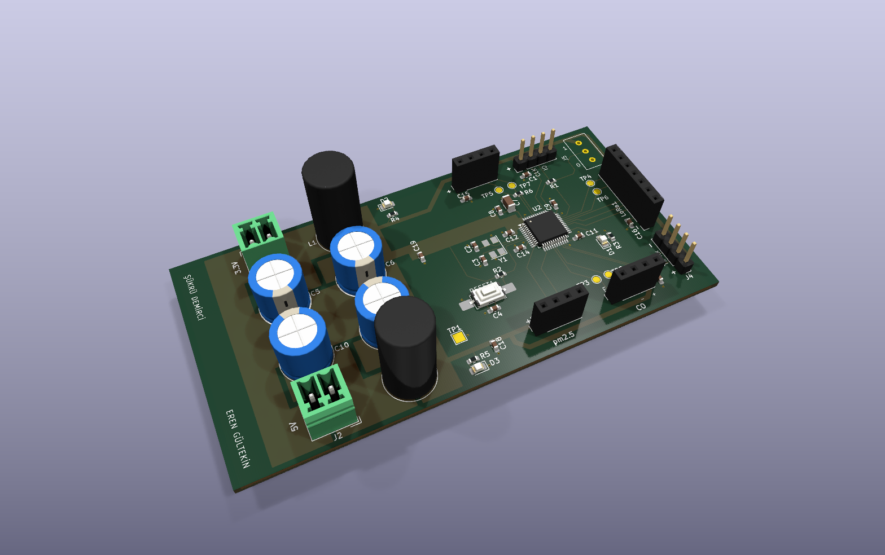
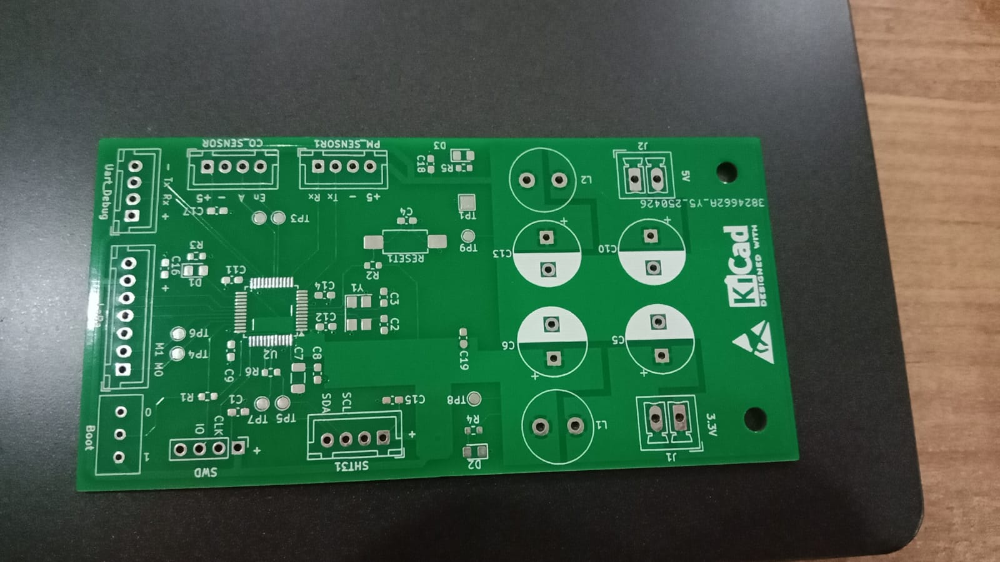

# Donanım

Sensör istasyonunun devre kartı KiCad 9 ile tasarlanmıştır. Kartın merkezinde STM32F103C8T6 mikrodenetleyicisi bulunur. Sensörler ve E220 LoRa modülü kart üzerindeki soketlere takılır.

<p align="center">
  
  
</p>

## Kart özellikleri

| Özellik | Değer |
|---|---|
| Boyut | 100 × 50 mm |
| Katman | 2 (F.Cu, B.Cu) |
| Kalınlık | 1,6 mm, FR-4 |
| Mikrodenetleyici | STM32F103C8T6, LQFP-48 |
| Besleme girişleri | J1: 3,3 V, J2: 5 V (Phoenix MC, 3,5 mm). Kart dışındaki buck ve boost dönüştürücülerden beslenir |
| Filtre | π tipi LC: L1, L2 = 100 µH ve C5, C6, C10, C13 = 1000 µF |
| Sensör soketleri | SDS011 (`pm2.5`), SHT31 (`SHT31`), MiCS-5524 (`J3`). Hepsi 2,54 mm |
| LoRa | E220-900T22D için 1×7 soket (`LoRa1`) |
| Programlama | SWD (`SWD1`, 1×4 pin), ST-LINK/V2 ile |
| Test noktaları | TP1–TP7: GND, ADC, EN, M0, M1, SCL, SDA |

## Dosyalar

| Dosya / klasör | Açıklama |
|---|---|
| `kicad/LoRa.kicad_pro` | KiCad proje dosyası. Bunu açın |
| `kicad/LoRa.kicad_sch` | Şematik |
| `kicad/LoRa.kicad_pcb` | Kart yerleşimi |
| `kicad/Library.pretty/` | Özel footprint'ler (buton, sürgülü anahtar) |
| `kicad/New_Library.kicad_sym` | Özel sembol (sürgülü anahtar) |
| `gerber/` | Üretime gönderilen Gerber ve delik (Excellon) dosyaları |
| `sema.pdf` | Şematiğin PDF çıktısı |
| `malzeme-listesi-kart.csv` | Şematikten üretilen kart malzeme listesi |

Kart dışı modüller ve ağ geçidi dahil tam liste için bkz. [`../belgeler/malzeme-listesi.md`](../belgeler/malzeme-listesi.md).

## Üretim

`gerber/` klasöründeki dosyalar 23 Nisan 2025'te KiCad 9 ile üretilmiştir. Kartı değiştirirseniz Gerber dosyalarını KiCad'den yeniden üretin:

```bash
kicad-cli pcb export gerbers -o gerber/ kicad/LoRa.kicad_pcb
kicad-cli pcb export drill   -o gerber/ kicad/LoRa.kicad_pcb
```

Bileşenler elle lehimlenebilecek kılıflardadır (0603 / 0805 / LQFP-48 / THT).

## Lisans

[CERN-OHL-P-2.0](../LICENSES/CERN-OHL-P-2.0.txt)
